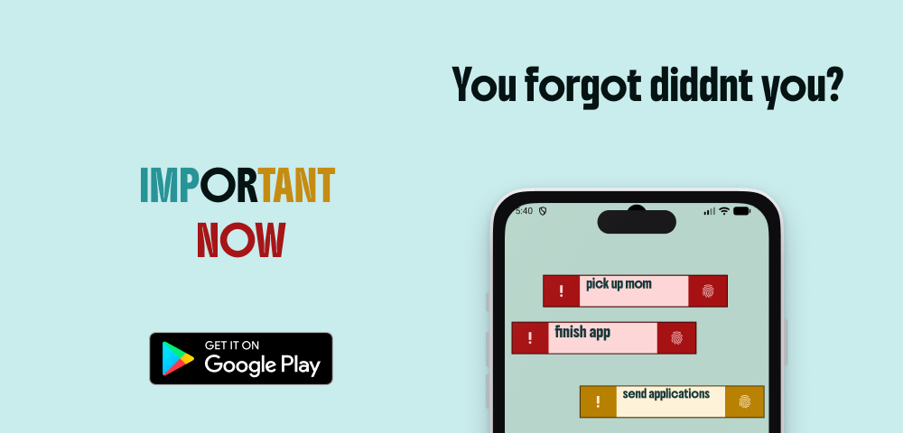

# Important Now
Yep, another CRUD app.

No AI agents. No agentic workflows. No AI CLI.

Just an Android app that shows **things you have to do** and their **priority levels**.

## Tech

- Kotlin
- Jetpack Compose
- Android SDK
- Room Database(SQL)

## License
This is free and unencumbered software released into the public domain.

Anyone is free to copy, modify, publish, use, compile, sell, or distribute this software, either in source code form or as a compiled binary, for any purpose, commercial or non-commercial, and by any means.

In jurisdictions that recognize copyright laws, the author dedicates any and all copyright interest in the software to the public domain.

THE SOFTWARE IS PROVIDED "AS IS", WITHOUT WARRANTY OF ANY KIND.

[The Unlicense](LICENSE)
